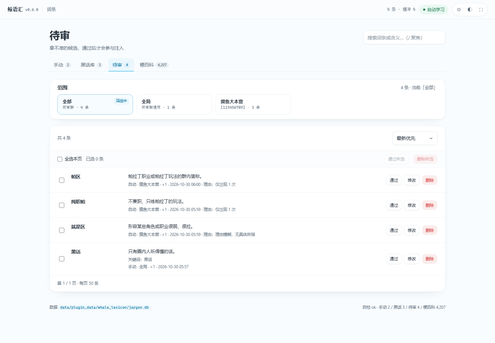
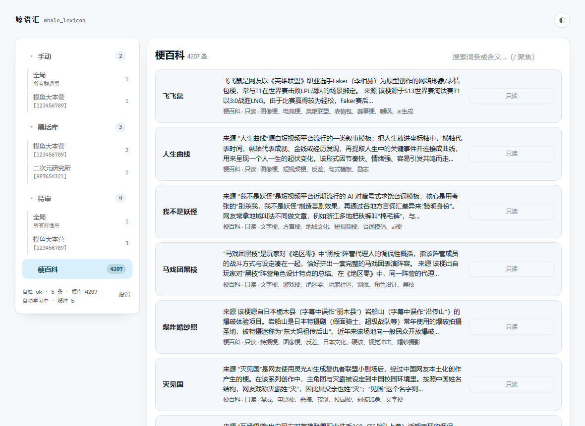
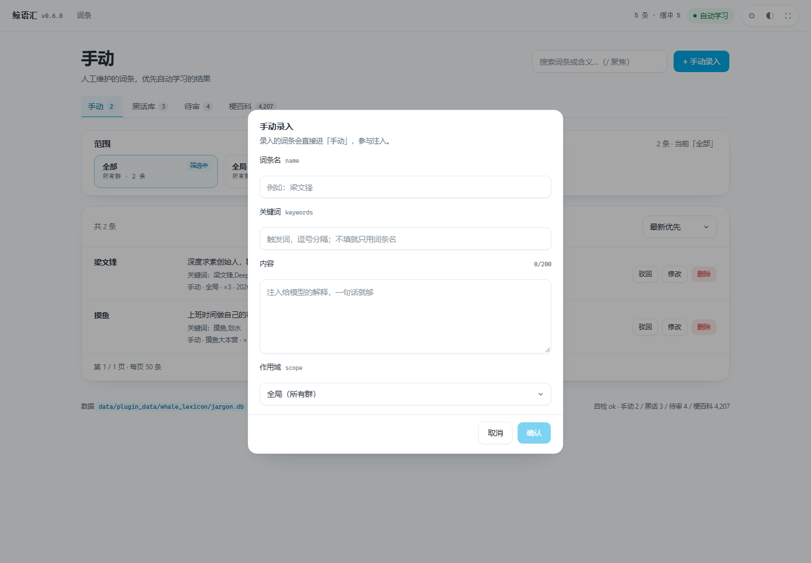
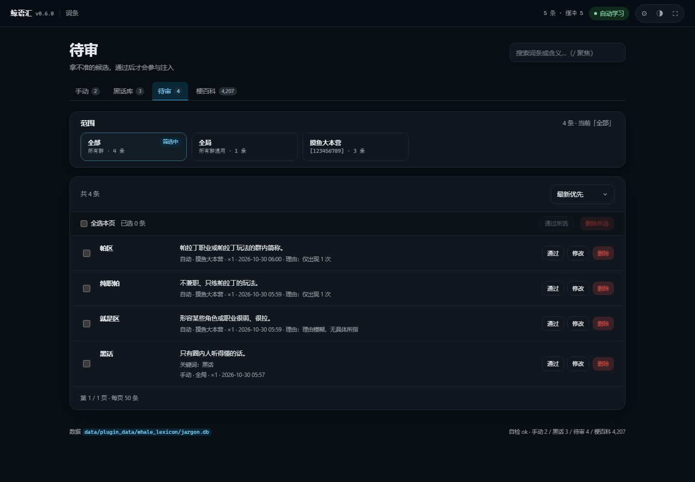

# 鲸语汇（whale_lexicon）

群黑话自学习插件，移植自 AstrBot 插件 `astrbot_plugin_slang`，适配 `qq-bot-lite`。

从群聊里攒消息 → 定期调本地模型提取黑话 → 模型自审（含义要具体、用法要稳定）
→ 进待审池 → 审核通过后，命中时注入到 system 提示词里。

## 为什么单开一个项目

词库、提取、审核这套逻辑跟具体机器人框架无关，塞进主仓库只会让两边都难维护。
这里是独立的 git 仓库，主项目通过 `[extensions] dirs` 登记这个目录来加载。

## 结构

```
whale_lexicon/
  plugin.toml        元数据与设置项（主面板里可改）
  plugin.py          与 qq-bot-lite 对接的胶水：攒消息、调模型、注入提示词、面板接口
  pages/index.html   网页面板
  core/              纯逻辑，不依赖任何机器人 API
    store.py         SQLite：四张词条表、缓冲区、群名、梗百科
    service.py       业务：去重、入库、审核、分页、匹配
    matcher.py       命中后的提示词拼装
    index.py         按首字符分桶的关键词索引
    miner.py         提取 + 自审（提示词沿用原插件打磨过的版本）
    wiki.py          梗百科同步（cnmeme.wiki 公开接口）
```

## 面板

访问 `/plugins/whale_lexicon/`。左栏是分类和按群展开的词条数，
右栏是列表 + 搜索 + 排序 + 录入，操作都在行内。



- 待审：模型学出来的候选，逐条「通过」进黑话库
- 黑话库：模型学的，参与注入；「驳回」退回待审
- 手动：自己录的，优先级最高
- 梗百科：cnmeme.wiki 的公开词条，只读，纯查词用





页面引的是主程序的 `/static/style.css`，所以配色、控件跟主面板一致，
主题跟着主面板走。

## 接口

全部在 `/plugins/whale_lexicon/` 下，返回 `{"ok": bool, "message": str, ...}`：

| 方法 | 路径 | 作用 |
|---|---|---|
| GET | `ping` | 自检：条数、字数上限、版本 |
| GET | `tree` | 侧栏：分类 + 按群计数 |
| GET | `list` | 分页列表（bucket / search / scope / scoped / page / size / sort） |
| POST | `lookup` | 录入前查重 |
| POST | `add` | 手动录入 |
| POST | `update` | 修改（名称、关键词、内容、作用域） |
| POST | `delete` | 删除 |
| POST | `approve` | 通过 / 驳回 |
| POST | `bulk` | 批量通过 / 删除 |
| POST | `learn` | 立刻学一批 |
| POST | `wiki/sync` | 同步梗百科 |

## 待办

- `/yh` 命令现在只有最小集（list / approve / del / learn / stats）
- 学习触发还只看条数，没做「冷场多少秒」的判断
