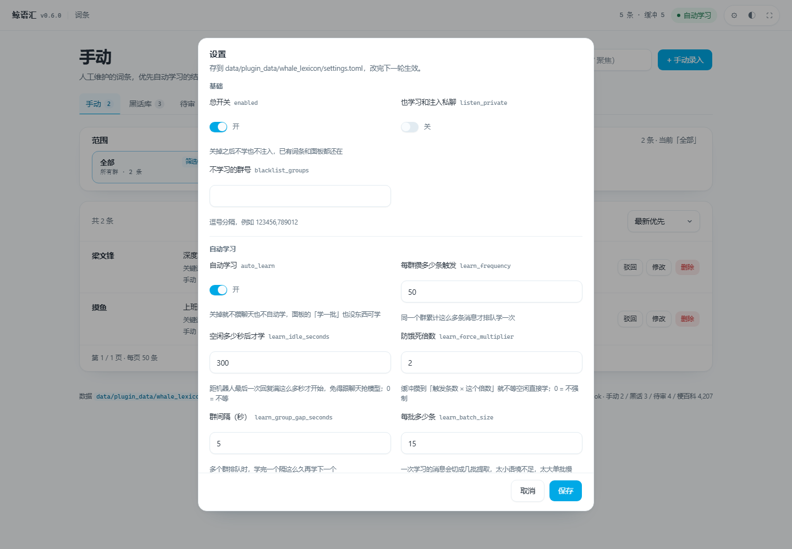

# 鲸语汇（whale_lexicon）

群黑话自学习插件，移植自 AstrBot 插件 `astrbot_plugin_slang`，适配 `qq-bot-lite`。

从群聊里攒消息 → 攒够一批、等机器人闲下来 → 分批调本地模型提取 → 模型自审
→ 确定的直接进黑话库、拿不准的进待审 → 命中时注入到 system 提示词里。
黑话没命中时，还会用梗百科兜底注一句。

## 为什么单开一个项目

词库、提取、审核这套逻辑跟具体机器人框架无关，塞进主仓库只会让两边都难维护。
这里是独立的 git 仓库，主项目通过 `[extensions] dirs` 登记这个目录来加载。

## 结构

```
whale_lexicon/
  plugin.toml        元数据与设置项（主面板里可改）
  plugin.py          对接层：攒消息、学习调度、注入、命令、面板接口
  pages/index.html   网页面板
  core/              纯逻辑，不依赖任何机器人 API
    store.py         SQLite：四张词条表、缓冲区、群名、梗百科
    service.py       业务：去重、入库、审核、分页、匹配
    index.py         按首字符分桶的关键词索引
    matcher.py       命中后的提示词拼装
    miner.py         分批提取 + 自审
    wiki.py          梗百科同步（cnmeme.wiki 公开接口）
```

## 学习是怎么触发的

1. 每条群消息进缓冲（`auto_learn` 关掉就不攒；黑名单群、没开私聊的私聊也不攒）
2. 同一个群攒够 `learn_frequency` 条，排进队列
3. 调度器每 5 秒看一次：距机器人最后一次回复满 `learn_idle_seconds` 才开始学，
   免得跟聊天抢模型；但缓冲攒到 `learn_frequency × learn_force_multiplier` 条时不等空闲
4. 单 worker 串行，学完一个群歇 `learn_group_gap_seconds` 秒再学下一个
5. 消息按 `learn_batch_size` 切批提取，批间歇 `learn_batch_delay_ms` 毫秒，
   单批超过 `learn_batch_timeout` 秒就跳过
6. 全部批次都失败（超时/断网）会保留缓冲，5 分钟后重试；只要有一批成功就继续
7. 合并候选 → 过滤拒绝词/空泛释义/同义反复 → 一次自审
8. 自审通过且本批出现 ≥2 次的直接进黑话库；其余进待审，理由写进词条

## 注入

- 先查黑话：手动 > 自动、长词优先，最多 `inject_max` 条，单条截到 `max_meaning_chars`
- 黑话没命中再查梗百科：只认标题，命中一条就带上，只让它接一句，不让它科普
- 群黑名单、没开的私聊，不注入

## 命令

都是管理员命令（`config.toml` 的 `[commands] admins` 为空时不限制）。

```
/yh list [页]            看已收录词条，8 条一页
/yh pending              看待审
/yh search 关键词         搜词条
/yh add global|group 名字 含义
/yh approve 名字          通过 / 驳回
/yh del 名字              删除
/yh promote 名字          升级为全局
/yh check 一句话          看这句话会注入什么
/yh learn                立刻学一批（后台跑，几十秒）
/yh stat                 统计 + 注入计数
```

## 设置

主面板「插件」→「设置」，按分组排列；梗百科那几项只在启用梗百科时才出现。



| 分组 | 键 | 说明 |
|---|---|---|
| 基础 | `enabled` / `listen_private` / `blacklist_groups` | 总开关、是否管私聊、屏蔽的群 |
| 自动学习 | `auto_learn` / `learn_frequency` / `learn_idle_seconds` / `learn_force_multiplier` / `learn_group_gap_seconds` / `learn_batch_size` / `learn_batch_delay_ms` / `learn_batch_timeout` / `extract_max` | 什么时候学、怎么分批 |
| 自动学习 | `learn_model` | 学习用哪个模型，留空跟聊天一样 |
| 自动学习 | `extract_thinking` / `review_thinking` | 提取、自审各自怎么关思考（下拉） |
| 自动学习 | `extract_extra_body` / `review_extra_body` | 只有选「自定义」才出现，填 JSON |
| 注入 | `inject_max` / `max_meaning_chars` | 注入几条、单条多长 |
| 候选过滤 | `reject_words` | 名字命中就丢，不送自审 |
| 梗百科 | `wiki_enable` / `wiki_sync_enable` / `wiki_sync_time` / `wiki_sync_interval_days` | 侧栏分类、定时同步 |

### 关思考：跟原插件同一套七档

| 选项 | 行为 |
|---|---|
| 自动识别（提取默认） | 按模型名猜参数；猜不到按 OpenAI 兼容处理 |
| 不处理 | 保持思考 |
| OpenAI / LM Studio | `reasoning_effort: "none"` |
| GLM | `thinking.type = disabled` |
| Gemini | `gm_thinking_config.budget = 0` |
| DeepSeek | 试 `reasoning_effort: "none"`，建议同时换 `deepseek-chat` |
| 自定义 | 显示 JSON 输入框，填什么发什么 |

- 只有选「自定义」才显示 JSON 输入框
- 后端不认这个参数：自动去掉重试一次，之后不再试，聊天不受影响
- 提取默认关思考、自审默认保持思考，形成混合模式；两者分开配
- 本机 LM Studio 实测：同一段聊天 11.8 秒 → 1.8 秒
- 想用更小的模型专跑学习：`learn_model` 选一个（下拉列表来自当前连着的模型服务）

`learn_model` 那个下拉就是插件设置面板的**兜底接口**在起作用：`plugin.toml` 里声明的
只是普通输入框，`settings_fields()` 在打开设置时去问模型服务要列表，拿到才换成下拉；
连不上或者接口出错，照旧是输入框。


## 面板

访问 `/plugins/whale_lexicon/`。左栏是分类和按群展开的词条数，
右栏是列表 + 搜索 + 排序 + 录入，操作都在行内。


顺序跟原插件一致：**手动**（知识库）→ **黑话库**（学来的）→ **待审**（审查）→ **梗百科**（兜底），
默认落在「手动」。

- 手动：自己录的，优先级最高
- 黑话库：模型确定过的，参与注入；「驳回」退回待审
- 待审：模型拿不准的，逐条「通过」进黑话库
- 梗百科：cnmeme.wiki 的公开词条，只读，纯查词用


## 接口

全部在 `/plugins/whale_lexicon/` 下，返回 `{"ok": bool, "message": str, ...}`：

| 方法 | 路径 | 作用 |
|---|---|---|
| GET | `ping` | 自检：条数、缓冲、注入计数、版本 |
| GET | `tree` | 侧栏：分类 + 按群计数 |
| GET | `list` | 分页列表（bucket / search / scope / scoped / page / size / sort） |
| POST | `lookup` | 录入前查重 |
| POST | `add` / `update` / `delete` | 增删改 |
| POST | `approve` / `bulk` | 通过、驳回、批量 |
| POST | `learn` | 立刻学一批 |
| POST | `wiki/sync` | 同步梗百科 |

## 许可

MIT，沿用原作者（贰叔）的 LICENSE。
